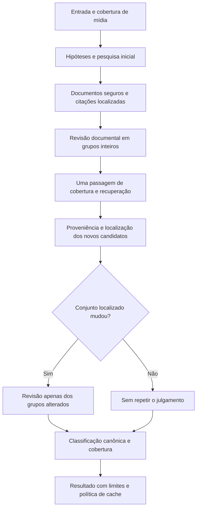

# Revisão integral do fluxo factual — versão 15

## Escopo

Revisão motivada pelos registros `934e145d-fe9e-45f8-aff6-aab7dd7af113`, seu cache `df644434-2d73-4ad6-ab06-be5940e80bce` e pela checagem adicional `ff1790d4-60b5-4e5e-8005-9b1e1d3ba80b`. Foram examinados entrada/mídia, decomposição, pesquisa/proveniência, obtenção e localização documental, revisão, classificação, agregação e cache. Produção foi consultada somente por GET autenticado; nenhum registro foi alterado ou republicado.

## Causas demonstradas

| Subsistema | Achado | Decisão |
| --- | --- | --- |
| Pesquisa/documentos | No caso Canella, Reuters/UOL devolveu 403 e a outra citação foi rejeitada; o sistema encerrava o ponto sem recuperação documental. | Uma passagem de cobertura e pesquisa documental, com novos candidatos sujeitos às mesmas validações. Não aceitar documento bloqueado como prova. |
| Localização | A citação literal do NF Notícias terminava em `[...]`; só omissões internas eram aceitas. | Aceitar cortes explícitos nas bordas, preservando âncoras e limites, sem reconstruir palavras. |
| HTML | Tags inline inseriam espaço antes de vírgula. Um parágrafo longo real do ICL ficava apenas `prefix`, apesar de todos os termos coincidirem. | Corrigir o artefato de extração em palavras/nomes, sem juntar números separados nem relaxar o fuzzy. |
| Revisão | A proposta de 67 anos tinha dois trechos pertinentes e localizados, mas foi rebaixada. | Revisão focada em relação documental e modalidade, não uma nova investigação da verdade ou exigência de execução/adesão. |
| Corte JEV e contexto | Replays da mesma proposta documentada escolheram `supports` entre 0,61 e 0,74; o piso 0,8 rejeitava até o vencedor com larga margem. Janela local também pode perder a identidade definida no início do documento. | Piso de classe 0,7 com margem 0,2 preservada; lead real limitado contextualiza identidade, sem substituir citação. Separar `context` (lacuna determinada) de `unclear` (relação ambígua), e implicação de identidade integral. Não há garantia de calibração nem de eliminar abstenções. |
| Classificação | A mesma relação `context` mantinha 70 quando o avaliador inicial sugeria `context`, mas ficava sem nota quando sugeria `unproven`. Observado também em execução real do Bolsa Família. | Classificação canônica pela revisão: suporte completo → verdadeiro; refutação completa → falso; componente sem prova → abstenção. Aplicação e validação não dependem do palpite inicial. |
| Orçamento de revisão | A fatia global de citações podia deixar claims posteriores sem chance de revisão. Não foi a causa do caso de 67 anos, que tinha nove citações. | Teto por alegação e lotes de grupos inteiros. Overflow explícito, sem confirmação parcial em falha de lote. |
| Cobertura | Foram observadas decomposições diferentes, combinações de programas e omissões/atenuações do enunciado original. | Rubrica preserva sujeito/predicado/força; passagem de cobertura pode recuperar afirmações omitidas, com citação literal da entrada. Não reescreve hipóteses existentes nem transforma extração em comprovação. |
| Cache | Uma execução subsequente do caso Canella reutilizou o resultado operacionalmente limitado. | Resultados sem comprovação e revisão indisponível/inconclusiva não entram/não são reutilizados no cache de 24h. Contexto insuficiente validamente revisado pode ser cacheado. |
| Segurança e agregação | SSRF, proveniência e abstinência agregada protegem contra fontes inventadas e médias parciais. | Mantidos. Uma afirmação documentada não autoriza confirmar outra; um ponto não resolvido continua impedindo nota global. |

## Fluxo implementado

A recuperação usa o mesmo pesquisador configurado, não um fallback de provedor. Ela recebe hipóteses fixas, entrada disponível e textos dos documentos obtidos (12 mil caracteres por documento/36 mil no total), além de URLs de pesquisa identificadas como pistas. Novas fontes exigem proveniência rastreável; citações precisam existir no documento. Novos claims de cobertura exigem trecho literal na entrada e começam `unproven`. Campos de status/score ou mudanças de texto vindos dessa etapa são ignorados. Operandos ausentes podem recuperar a citação do identificador original sem alterar valores/períodos da comparação.

Somente conteúdo documental efetivamente novo causa outra revisão; reordenar ou duplicar citações não conta. Não há loop de retries até superar o corte. Na versão 15, o piso JEV passa de **0,8 para 0,7**, preservando margem **0,2**. A mudança vale para todo grupo, não contém nomes, assuntos ou URLs especiais. O orçamento compartilhado de documentos/bytes permanece aplicável, inclusive quando a recuperação não encontra espaço para outra fonte.

## Auditoria humana da checagem adicional

- **Recebimento do projeto:** documentado. O número de participantes foi reportado como cerca de 500, mas há versões com 2 mil/2.500; presença no evento não prova autoria por 500 empresários.
- **67 anos, homens e mulheres:** documentado como proposta, com transições. Não exige provar regra vigente nem adesão do candidato.
- **BPC e seguro-desemprego abaixo do mínimo:** não comprovado nas fontes alcançadas. Prova sobre piso do RGPS não prova esses benefícios; outra proposta de outro grupo não pode ser importada para este projeto.
- **“Profundo corte” no Bolsa Família:** há revisão cadastral e possível exclusão, mas não magnitude documentada. Não converter automaticamente “revisão” em “corte profundo”.
- **Aposentadorias abaixo do mínimo:** a documentação sustenta desvinculação e possibilidade futura, não corte automático ou inevitável. A normalização não deve suavizar silenciosamente uma afirmação categórica para confirmá-la.

Fontes efetivamente confrontadas:

- [ICL Notícias, 15/10](https://iclnoticias.com.br/flavio-empresarios-aposentadoria-bolsa-familia/).
- [Diário do Comércio/ACSP, 13/10](https://dcomercio.com.br/publicacao/s/setor-produtivo-entrega-a-flavio-propostas-para-melhorar-ambiente-de-negocios).
- [Facesp, republicação](https://facesp.com.br/associacoes-comerciais-entregam-a-flavio-bolsonaro-propostas-para-melhorar-ambiente-de-negocios/) — não contar como apuração independente do Diário do Comércio.
- [NF Notícias, prisão e operação](https://www.nfnoticias.com.br/noticia-56943/pf-prende-deputado-marcio-canella-e-ex-secretario-de-policia-civil).
- [Valor, declaração anterior do candidato](https://valor.globo.com/politica/eleicoes-2026/noticia/2026/10/08/flavio-bolsonaro-diz-que-vai-fazer-ajuste-acima-da-inflacao-para-aposentadorias.ghtml).
- [Folha de Pernambuco/Agência O Globo, outra proposta previdenciária](https://www.folhape.com.br/economia/aumento-da-idade-bpc-menor-capitalizacao-mudancas-propostas-por/509229/).

Não foi localizado o plano integral; resumos das entidades proponentes não equivalem à auditoria de todos os capítulos. A gravação do encontro foi localizada, mas não foi ouvida/transcrita integralmente nesta auditoria.

## Provas de execução

1. **Replay com hipóteses/documentos fixos:** o caso ICL manteve recebimento e possibilidade previdenciária documentados, confirmou os 67 anos e não confirmou BPC/seguro nem corte profundo. A classe de suporte dos 67 anos chegou a 0,80 nessa chamada: é saída do classificador, não probabilidade de verdade.
2. **Replay Canella com o 403 registrado preservado:** a citação NF de borda passou a ser localizada; ainda assim, seu trecho isolado não bastou à relação completa. Isso demonstra por que corrigir apenas o localizador não bastava e por que não se deve promover automaticamente uma fonte acessível.
3. **Fluxo real completo do link Canella:** duas execuções completas posteriores confirmaram apoio, prisão e contexto investigativo (agrupados em duas ou três hipóteses), score 95. A última levou 54.706 ms, com aquisição/transcrição/visão e busca/documentos/JEV reais. A recuperação de cobertura executou sem novo julgamento quando os documentos não mudaram.
4. **Fluxo real completo do post adicional:** executou pesquisa, documentos, revisão, cobertura/recuperação e revisão dos grupos alterados. Recebimento e idade foram confirmados; BPC/seguro permaneceu sem comprovação. A execução levou 33.317 ms. A sugestão preliminar `context` para corte profundo foi observada como fonte de dependência do palpite inicial e a validação canônica posterior sobre os mesmos dados reais retirou os 70 pontos, mantendo abstenção.
5. **Parágrafo ICL com tags inline:** o mesmo conjunto recuperado que antes falhava foi relido após a correção HTML; a citação longa passou a `exact`, recebimento/idade foram confirmados e as extrapolações permaneceram sem confirmação. A citação com data reformulada de outra fonte continuou rejeitada: não houve relaxamento para aceitar paráfrase.
6. **Diagnóstico residual do piso:** outro fluxo completo, de 74.243 ms, ainda deixou a idade sem nota. Nos replays controlados, o JEV escolheu suporte entre 0,61 e 0,74, inclusive com grupo isolado e com lead, abaixo de 0,8. Isso motivou o ajuste explícito de piso, não uma repetição em produção até mudar a resposta. O replay da resposta real de 0,74, pela classificação/validação atuais, confirmou os 67 anos e manteve BPC, seguro, aposentadoria categórica abaixo do piso e corte profundo sem nota; 0,61 continua inconclusivo.
7. **Fluxo completo final, após todas as mudanças:** 52.150 ms, seis hipóteses, três confirmadas (recebimento, encontro de cerca de 500 representantes, idade de 67 anos para ambos os sexos) e três sem prova suficiente (BPC/seguro, corte profundo e aposentadorias categoricamente abaixo do mínimo). A idade recebeu suporte 0,93 nessa chamada; não atribuir esse resultado isoladamente à redução do corte. A formulação categórica sobre aposentadorias foi preservada, em vez de substituí-la por mera possibilidade futura.
8. **Controles sintéticos do revisor real:** 12 pares de afirmação/documento, distintos de notícias reais. O teste inicial de rótulos brutos falhou: `context`/`unclear` não são o mesmo rótulo, embora ambos terminem sem nota; houve ainda falsa refutação temporal com texto de 2022 para alegação nova de 2026. No replay dessas respostas pela aplicação/validação, com os períodos 2022/2026 explicitamente estruturados para testar essa proteção, as 12 decisões finais corresponderam ao esperado. Isso prova a proteção quando os períodos são conhecidos, não que o JEV extraia corretamente datas ausentes. Proposta resumida, prisão como suspeita e fala atribuída foram confirmadas; acusações não confirmaram o crime, RGPS não confirmou BPC, ausência de magnitude não confirmou corte profundo e componente ausente não confirmou o conjunto.

As execuções foram locais, com armazenamento/cache compartilhados desabilitados e `storage.persisted: false`. JSONs privados permanecem somente em `tmp-dl/`, ignorado pelo Git. Nenhum resultado publicado foi retificado automaticamente.

## Limites e tradeoffs

A alteração remove dependências mecânicas demonstradas; não torna pesquisa ou decomposição por modelo determinísticas. Foram observadas variações de número/forma de claims e a auditoria de cobertura não identificou toda omissão em todas as chamadas. A âncora literal restringe inserções, mas não prova que a interpretação seja correta; JEV ainda pode errar a relação semântica, inclusive confundir ausência com refutação. Guardas temporais só protegem períodos estruturados conhecidos. Reduzir o piso pode aumentar classificações incorretas, e não elimina toda abstenção documentada. A passagem documental adicional aumenta custo e latência. Não foi produzido corpus humano representativo nem taxa geral de precisão/recall. Não há promessa de que toda nova execução da mesma entrada encontrará as mesmas fontes; diferenças documentais e novas informações continuam possíveis.

## Verificação de engenharia e interface

- Suíte completa: **303 testes aprovados**, sem falhas, com armazenamento externo removido somente do subprocesso de testes. Regressões incluem prevalência canônica para todos os quatro status iniciais, starvation de claims posteriores, grupo indivisível, recuperação após fonte bloqueada, rejeição de URL sem proveniência/citação inventada, ausência de rejulgamento do mesmo conjunto, omissões ancoradas, cache e HTML com tags inline.
- Lint final sem erros (dez avisos React já observados) e build concluído. A verificação intermediária dos módulos afetados também passou com 135 testes.
- Navegador local: progresso e resultado renderizados com replay dos eventos/resultados reais do smoke, não uma nova inferência web. A etapa de cobertura foi observada em andamento; recebimento/67 anos apareceram confirmados e as lacunas sem nota, sem overflow horizontal no viewport observado. A metodologia pública final foi conferida na prévia do build: versão 15, piso 0,7 anterior 0,8, margem 0,2 e política canônica visíveis, sem overflow horizontal.
- Os scripts temporários de diagnóstico/smoke são removidos após a coleta; os JSONs de evidência permanecem apenas no diretório ignorado.
